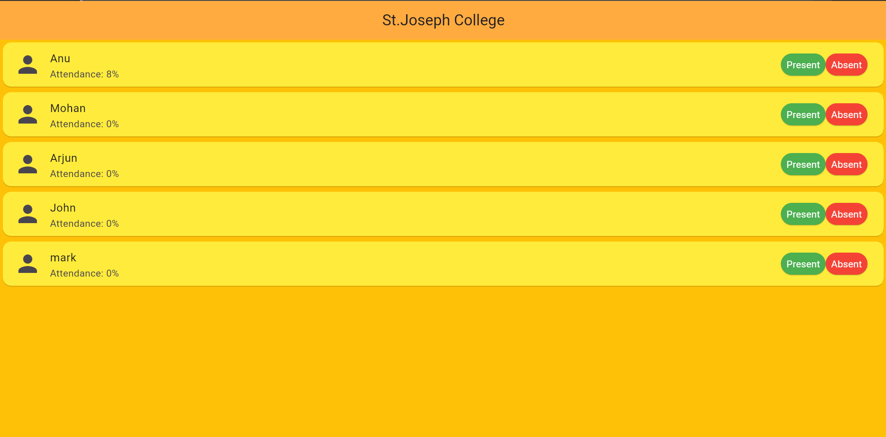

# Student Attendance Management App

A Flutter application developed to manage student
attendance and display individual student profiles.

## Features
- Student list
- Mark students present or absent
- Calculate attendance percentage
- Individual student profile
- Circular attendance progress indicator

## Technologies Used
- Flutter
- Dart
- Material UI

## Screenshots
Home:
Profile:

## Future Improvements
- Add student functionality
- Store attendance data
- Attendance history
